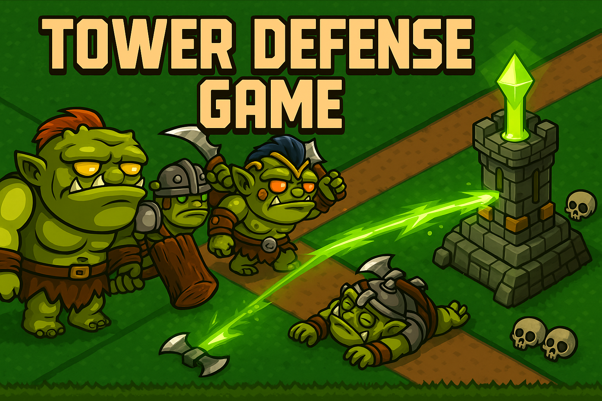

# Tower Defense Game

🎮  Tower Defense Game — Defenda a Base. Proteja o Caminho.

Tower Defense Game é um jogo do gênero Tower Defense, desenvolvido em Java + Swing, onde o jogador deve impedir que hordas de inimigos atravessem o mapa e destruam a base.

Posicione torres estrategicamente, administre seus recursos, melhore suas defesas e sobreviva às ondas inimigas.

Este projeto foi construído com foco em:

Gameplay fluido

Arquitetura orientada a objetos

Boa estruturação de pacotes

Uso de sprites, animações e efeitos visuais

🗺️ Como o jogo funciona

As áreas verdes permitem construir torres.

O caminho marrom é por onde os inimigos avançam.

Seu objetivo: não deixar nenhum inimigo alcançar a base.

Use sua economia para:

construir torres

fazer upgrades

preparar-se para ondas mais fortes

👾 Inimigos

Cada inimigo possui vida, dano, velocidade e comportamentos únicos.

🧟 Zumbi

Vida: 8

Dano: 1

Velocidade: 1

O mais básico — resistente, porém lento.

🏃 Corredor

Vida: 5

Dano: 1

Velocidade: 2

Rápido e imprevisível — exige torres ágeis.

🛡️ Blindado

Vida: 6

Dano: 2

Velocidade: 1

Imune a efeitos especiais como veneno e congelamento.

🪨 Golem

Vida: 6

Dano: 2

Velocidade: 1

Perigoso ao morrer: divide-se em dois Golemitas.

🏰 Torres Disponíveis

Cada torre possui suas próprias características, custo, alcance e efeito especial.

🏹 Torre Arqueira

Dano: 2

Cooldown: 2

Alcance: 3

Efeito: Flecha rápida

Ideal contra inimigos velozes.

🧪 Torre Poison

Dano: 2

Cooldown: 2

Alcance: 3

Efeito: Veneno contínuo

Excelente contra inimigos de alta vida.

❄️ Torre Frozen

Dano: 2

Cooldown: 2

Alcance: 3

Efeito: Congelamento (Lentidão)

Essencial para controlar grupos de inimigos.

🧠 Arquitetura resumida

Projeto dividido em pacotes:

model/          # Inimigos, Torres, Projéteis, Economia, Animações
ui/             # GamePainel, HUD, Janelas
jogo/           # GameLoop, WaveManager, controlador do jogo
assets/         # Sprites PNG, animações e decoração

O motor do jogo é baseado em:

GameLoop com ticks

Herança para inimigos e torres

Polimorfismo nos projéteis

Swing para renderização

Sprites e rotação com AffineTransform

▶️ Como executar o jogo
💠 Pré-requisitos

Java 17+

Terminal PowerShell ou equivalente

💠 Compilar o projeto

Windows (PowerShell):

$files = Get-ChildItem -Recurse -Filter *.java .\src\ | ForEach-Object { $_.FullName }
javac -d bin $files

Linux/macOS:

javac -d bin $(find src -name '*.java')

💠 Executar o jogo
java -cp bin app.Main

📝 Licença

Projeto aberto para fins educacionais e demonstrativos.
© 2025 — Gabriel Esteves dos Santos Silva.

📚 Documentação

As decisões de design de cada etapa do projeto estão em docs/justificativa-design.md e docs/design-justificativa-ui.md.
